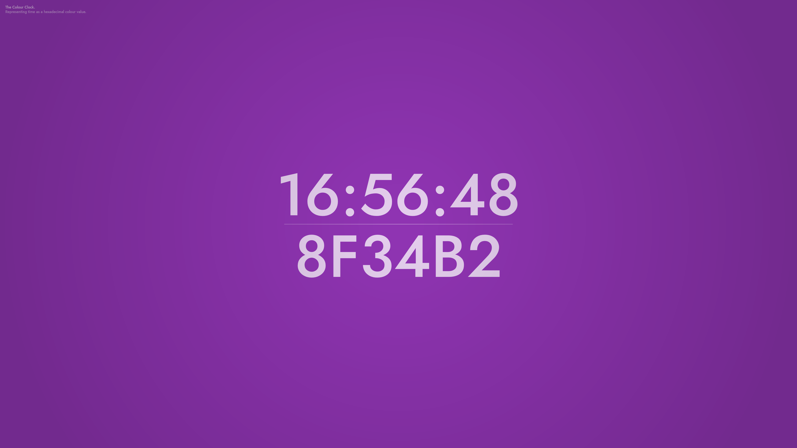
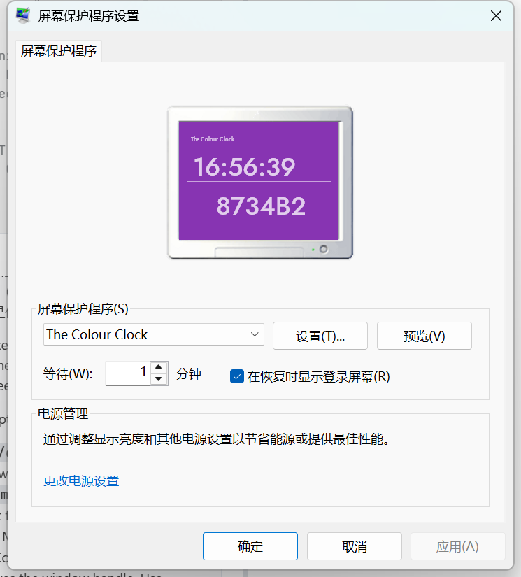
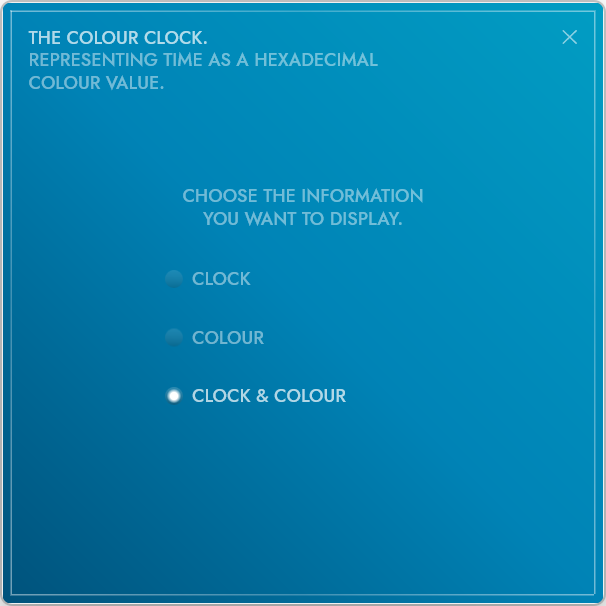
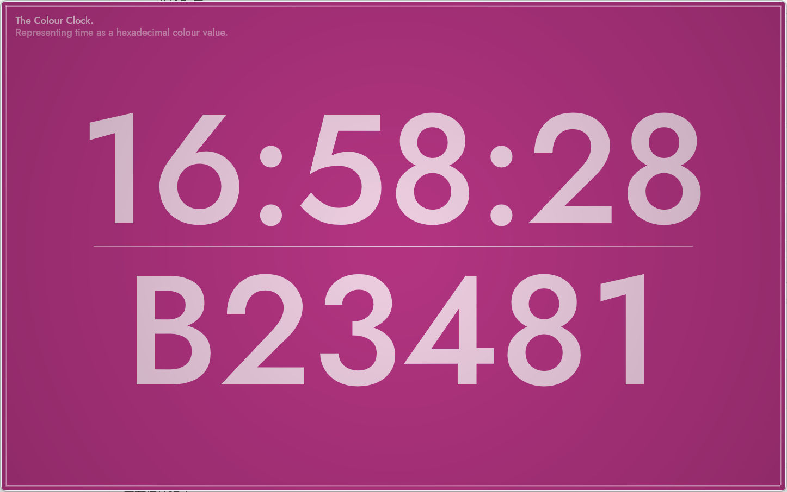

# The Colour Clock

Windows 屏保 / 桌面时钟：把当前时间映射成一种颜色，并显示对应的十六进制色值。
本仓库是对原 Flash 版《The Colour Clock》的**去 Flash 重写**，使用 WinUI 3（Windows App SDK）
重新实现，视觉布局还原原版，代码完全重写。



## 截图

| 屏保设置（系统对话框） | 设置窗口 |
| --- | --- |
|  |  |

桌面时钟窗口：



## 功能

- **屏保**：支持 Windows 屏保的全部启动参数 —— `/s` 全屏、`/c` 设置、`/p <hwwnd>` 预览、`/a`；
  多显示器时每块屏幕各开一个窗口。
- **任意输入退出**：鼠标移动、点击或按键都会结束屏保（带 1.5 秒启动宽限期，避免启动瞬间误退）。
- **颜色平滑循环**：色相在 HSL 色彩轮上连续旋转，**每 15 分钟走完一整圈**（一天 96 圈），
  每秒采样一次，单秒通道变化约 1 级，不会出现跳色或突变。
- **色值与颜色严格一致**：背景色与屏幕上的十六进制代码由同一个函数、同一时刻生成，
  不做颜色补间，因此看到的就是代码所表示的颜色。代码为 `B234A1` 这种 6 位大写形式，
  与原版 Flash 一致，**不加 `#`**。
- **三种显示模式**：仅时钟、仅颜色、时钟 + 颜色（设置窗口中切换，立即生效并保存到 JSON）。
- **桌面时钟**：无参数启动时显示可拖动的窗口，`F11` 全屏、`Esc` 关闭、`Ctrl+,` 打开设置。

## 系统要求

- Windows 10 2004（19041）及以上 / Windows 11，x64。
- 安装需要管理员权限（程序装到 `Program Files`，屏保启动器装到 `System32`）。

## 构建

依赖：

- .NET 8 SDK（`dotnet` 需在 PATH，或位于 `%LOCALAPPDATA%\Microsoft\dotnet\dotnet.exe`）
- Inno Setup 6（用于生成安装包）
- Windows 上自带的 .NET Framework 4.x 编译器（`csc.exe`，用于编译 System32 启动器）

在仓库根目录执行：

```powershell
powershell -ExecutionPolicy Bypass -File .\build.ps1
```

脚本依次完成：

1. 编译 `installer/stub/ColourClockStub.cs` → `installer/build/TheColourClock.scr`（约 60 KB 的启动器）；
2. `dotnet publish src\ColourClock.App`（Release，self-contained win-x64）；
3. 编译 `installer/TheColourClockSetup.iss` → `dist\TheColourClockSetup.exe`。

首次构建会通过 NuGet 还原 Windows App SDK，需要联网。

## 安装与卸载

运行 `dist\TheColourClockSetup.exe`（会请求 UAC）。安装程序会：

- 把完整应用装到 `C:\Program Files\The Colour Clock`；
- 把一个很小的启动器 `.scr` 写入 `C:\Windows\System32`，并注册
  `HKCU\Control Panel\Desktop\SCRNSAVE.EXE` 指向它。

### 为什么屏保要放在 System32

Windows 的“屏幕保护程序设置”下拉框只枚举 `%SystemRoot%\System32\*.scr`，
放在其他目录的 `.scr` 既不会出现在列表中，还会让系统把当前屏保重置成“（无）”。
而 WinUI 应用的 `ms-appx:///Assets/...` 资源又是按可执行文件所在目录解析的，
不能把 160 MB 的整个应用塞进 System32。因此这里采用：

```
System32\The Colour Clock.scr   -> 约 60 KB 启动器（转发 /s /c /p /a 给真实 exe）
Program Files\The Colour Clock  -> WinUI 应用本体与资源
```

启动器通过 `HKLM\SOFTWARE\The Colour Clock\InstallPath` 找到真实安装目录。

卸载：在“设置 → 应用”中卸载，或运行 `C:\Program Files\The Colour Clock\unins000.exe`。
卸载会删除 System32 中的启动器并清除屏保注册表值。

## 项目结构

```
src/
  ColourClock.Core/          时间 → 颜色、布局常量、设置模型（与 UI 无关）
  ColourClock.App/           WinUI 3 外壳：屏保会话、设置窗口、桌面时钟、/p 预览
installer/
  TheColourClockSetup.iss    Inno Setup 脚本（管理员安装 + System32 启动器）
  stub/ColourClockStub.cs    System32 中的 .NET Framework 启动器
build.ps1                    一键构建
docs/screenshots/            README 截图
```

## 实现备注

- `/p` 预览是嵌入系统设置对话框的跨进程子窗口，继承对话框的 DPI 上下文，
  因此 GDI 字号按 `96 / LOGPIXELSY` 做了补偿，否则文字会被放大后裁切。
- 屏保全屏时会移除 `WS_CAPTION/WS_THICKFRAME/WS_BORDER`、关闭 DWM 强调色边框与圆角，
  避免屏幕边缘出现 1~2px 亮线或四角露出桌面。
- 若在系统设置里勾选“在恢复时显示登录屏幕”，屏保被操作退出后会正常进入锁屏，这是 Windows 行为。

## 字体

界面使用 **Jost**（SIL Open Font License 1.1），字体文件位于
`src/ColourClock.App/Assets/Fonts/Jost.ttf`，许可证见同目录 `OFL.txt`。

## 致谢

- 原始创意与视觉参考自 Flash 版《The Colour Clock》。
- 本项目不含任何原版程序代码或二进制文件，反编译仅用于理解行为与版式。
